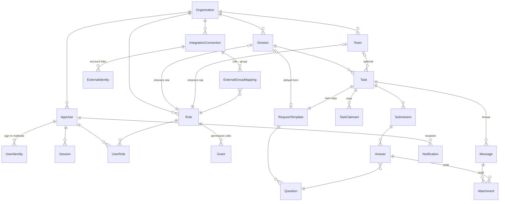

# Patrice: The Existing Architecture

> **What this is.** A description of Patrice **as the code actually builds it**, written as groundwork for a redesign. It was put together only from the source, the schema, the migrations, the deploy files and code comments. The earlier design documents (now in [`docs/old/`](old/)) were deliberately not used.
>
> **What this is not.** A judgement. The problems, risks and failings are in the companion document, [current-design-problems.md](current-design-problems.md). Whether each design decision has a strong use case is graded in [current-design-decisions.md](current-design-decisions.md). How the code compares with the original design docs, and the direction decided for the redesign, is in [intent-vs-reality.md](intent-vs-reality.md). The resulting work is ordered in [redesign-plan.md](redesign-plan.md). This document describes the design and says what it assumes and what it limits. It doesn't argue about whether those choices were right.
>
> Snapshot: `main` at `c322ae2` (November 2026).

---

## How to read this document

Each major section starts with an **In brief** paragraph. If you only want the overall shape, read those paragraphs and the diagrams. The detail below each summary is for when you need the mechanism.

| §  | Section | Read it if you want to know… |
|----|---------|------------------------------|
| 1  | [The system at a glance](#1-the-system-at-a-glance) | what Patrice does and what it is built from |
| 2  | [Runtime topology](#2-runtime-topology) | which processes exist and what each one runs |
| 3  | [The request pipeline](#3-the-request-pipeline) | what happens to every HTTP request |
| 4  | [The domain model](#4-the-domain-model) | the entities and how they relate |
| 5  | [Cross-cutting conventions](#5-cross-cutting-conventions) | lifecycle, retirement, audit, errors, IDs |
| 6  | [Authorization](#6-authorization-the-cedar-engine) | how "may this user do this?" is answered |
| 7  | [Identity, accounts and sessions](#7-identity-accounts-and-sessions) | sign-up, login, bootstrap, Discord sign-in |
| 8  | [The work lifecycle](#8-the-work-lifecycle-tasks-claims-submissions) | tasks, claims, submissions, review, status |
| 9  | [Conversation and files](#9-conversation-and-files-messages-and-attachments) | message threads and attachments |
| 10 | [Notifications](#10-notifications) | in-app notifications and the live stream |
| 11 | [Background work](#11-background-work-queue-email-gc) | the job queue, email and garbage collection |
| 12 | [The Discord integration](#12-the-discord-integration) | role sync between Patrice and Discord |
| 13 | [The web client](#13-the-web-client) | how the Angular SPA is put together |
| 14 | [Configuration surfaces](#14-configuration-surfaces) | what is env config and what is runtime config |
| 15 | [Testing and delivery](#15-testing-and-delivery) | CI, tests, release |
| 16 | [Assumptions the design makes](#16-assumptions-the-design-makes) | the full list, in one place |
| 17 | [Limitations the design imposes](#17-limitations-the-design-imposes) | what you can't do without changing the design |

---

## 1. The system at a glance

**In brief.** Patrice coordinates work inside one organization. Someone (the **requester**) posts a **task** in a **division**. The task carries a form of questions (its **request template**). Eligible members **claim** open slots on the task, **submit** answers, and the requester **reviews** each submission. Who may do what is decided by a configurable permission matrix that is compiled into **Cedar** policies. Accounts exist only by **invitation**. An optional **Discord integration** keeps Patrice roles and Discord server roles in sync.

**Technology**

| Tier | Stack |
|------|-------|
| API / worker | Node 22, NestJS 11 (Express), Prisma 6, PostgreSQL 18, pg-boss 10 (Postgres-backed jobs), `@cedar-policy/cedar-wasm` 4, argon2, nodemailer, `ws` (Discord Gateway), AWS SDK (S3, KMS) |
| Web | Angular 19 (standalone components, signals), Tailwind 3, served by nginx |
| Storage | PostgreSQL for everything relational. Blobs go to S3-compatible storage or the local filesystem. |
| Delivery | Docker images on GHCR, built by tag-triggered GitHub Actions. The production stack is Docker Compose. |

**Source layout**

```
api/
  prisma/schema.prisma          the data model (+ hand-written SQL in migrations/)
  src/
    access/                     Cedar engine, action vocabulary, guards, admin-floor
    auth/ discord-auth/         passwords, sessions, verification, Discord OAuth login
    invitations/                invitations + bootstrap (first-admin) mode
    roles/ divisions/ teams/    org structure
    grants/                     the permission matrix
    users/                      users, membership, org settings ("config")
    request-templates/          question sets + the pure answer validator
    tasks/ submissions/         the work lifecycle + status roll-up
    messages/ attachments/      task threads and files (+ storage/)
    notifications/              per-user notification rows + SSE stream
    activity/                   append-only audit log
    queue/ email/ gc/           background jobs
    integrations/               Discord connection, linking, sync, Gateway
web/src/app/
  core/                         API client, stores, guards, interceptors
  pages/ features/              screens and reusable feature components
deploy/                         production compose bundle
```

The API code is grouped **by feature module**. Each module has a controller, a service and DTOs, and the services talk to Prisma directly. The project has no repository layer and no domain-object layer. Business rules live inside the service methods.

---

## 2. Runtime topology

**In brief.** A single build of the API runs in one of three **process roles**, chosen by the `PROCESS_ROLE` environment variable: `api` (HTTP), `worker` (background jobs and the Discord Gateway) and `combined` (both, the default for development and tests). In production, nginx serves the SPA and reverse-proxies `/api/*` to the API. The API and the worker share one Postgres database and one storage volume.

```
                 Browser (Angular SPA)
                        │  same origin, cookies
                        ▼
                ┌──────────────┐
                │  web (nginx) │  serves SPA, proxies /api/* ─┐
                └──────────────┘                               │
                                                               ▼
┌───────────────────────────┐        ┌───────────────────────────────┐
│ api  (PROCESS_ROLE=api)   │        │ worker (PROCESS_ROLE=worker)  │
│ • HTTP controllers        │        │ • no HTTP listener            │
│ • bootstrap seeding       │        │ • Discord sync consumers+cron │
│ • SSE notification stream │        │ • Discord Gateway websockets  │
│ • (also: GC + email       │        │ • GC + email consumers        │
│   consumers, see §11)     │        │                               │
└────────────┬──────────────┘        └──────────────┬────────────────┘
             │        ┌──────────────────────┐      │
             └───────►│ PostgreSQL 18        │◄─────┘
                      │ (data + pg-boss jobs)│
                      └──────────────────────┘
             shared volume /app/var/storage (local-fs blob driver)
```

**Where each role is decided**

- [`main.ts`](../api/src/main.ts) boots an HTTP app for `api` and `combined`, and a headless Nest application context for `worker`.
- Each background feature checks the role for itself, using `isApiRole` / `isWorkerRole` from [`common/process-role.ts`](../api/src/common/process-role.ts). Only three places check:
  - `BootstrapService` runs only where HTTP runs.
  - `SyncService` and `IntegrationGatewayService` run only in worker roles.
  - `EmailService` and `GcModule` **don't check**, so they register their pg-boss consumers in every process (§11).
- A separate one-shot `migrate` container runs `prisma migrate deploy` before `api` and `worker` start ([deploy/docker-compose.prod.yml](../deploy/docker-compose.prod.yml)). The dev compose migrates on boot instead.

**Cross-process communication** goes only through the database:
- jobs are rows in pg-boss tables
- the worker writes connection health fields (`gateway_state`, `sync_state`, …) that the API reads
- notifications are rows

The process-local in-memory state includes the Cedar policy cache (§6), the notification pub/sub (§10), the bootstrap invite token (§7), the Gateway health map and the set of open Gateway sockets (§12). None of it is shared between processes. There is also **no API → worker control channel**: when an admin changes a connection in the API, the worker can't be told to open, close or re-key a Gateway socket. Those changes take effect when the worker next restarts.

---

## 3. The request pipeline

**In brief.** Every request goes through three global guards in a fixed order: **throttle → session → authorize**. Validation happens in per-route Zod pipes, and errors are normalized by one global filter. The order matters: the authorization guard runs **before** body validation, so it reads the raw request.

```
request
  │
  ├─ helmet, cookie-parser(SESSION_SECRET), CORS(PUBLIC_BASE_URL), prefix /api
  │
  ├─ ThrottlerGuard   300 req/min/IP app-wide (in-memory store);
  │                   tighter @Throttle on auth/invite routes; skipped under NODE_ENV=test
  │
  ├─ SessionGuard     cookie → session row → req.user = {id, organizationId}
  │                   never denies for a missing session; denies only a failed CSRF check
  │                   (double-submit cookie vs X-CSRF-Token) on mutating cookie-authed requests
  │
  ├─ AuthorizeGuard   only for routes with @Authorize(action, resolver):
  │                   no req.user → 401; resolver loads the target → Cedar → 403 on deny
  │
  ├─ ZodValidationPipe (per @Body/@Query)  → 422 VALIDATION_FAILED
  │
  ├─ controller → service (Prisma, often one $transaction)
  │
  └─ AllExceptionsFilter → { error: { code, message, details? } }
```

**What this means in practice**

- A route **without** `@Authorize` is open to any authenticated caller. Each controller method writes `if (!req.user) throw new UnauthenticatedError()` by hand to enforce that.
- Read (`GET`) routes on tasks, submissions, messages, notifications and attachment downloads have no `@Authorize` (§6.6). Admin *list* endpoints borrow an unrelated mutating action, for example `GET /roles` requires `role:create`.
- Error status conventions: 401 unauthenticated, 403 denied, 404 missing, 409 conflict / optimistic-lock / state-machine violation, 410 consumed invite, 422 validation or domain refusal ([`common/errors.ts`](../api/src/common/errors.ts)).
- **Database errors.** The global filter turns a Prisma unique violation (`P2002`) that gets past the service's own pre-checks into `409 ALREADY_EXISTS`. Every other database error becomes `500 INTERNAL`, including foreign-key violations (`P2003`) and "record not found" (`P2025`).
- **DTO strictness varies.** Most DTOs are `.strict()`, so unknown fields are rejected with 422. List queries use `.strip()` instead. The integration DTOs aren't strict and accept an opaque `config` record and a raw `credentialsRef`.

---

## 4. The domain model

**In brief.** Everything belongs to one **Organization** row (a singleton). People are **AppUsers** with one or more sign-in **UserIdentities**. Authority comes from **Roles**, which users hold through **UserRole** and which carry **Grants** (permission-matrix cells). **Divisions** and **Teams** are org units, and each one automatically gets an *inherent role* that represents membership. Work is a **Task** in a division. The task owns a copy of a **RequestTemplate** (its questions), has **TaskClaimant** slots, collects versioned **Submissions** of **Answers**, and hosts a **Message** thread with **Attachments**. Side tables record **Activity** (audit), **Notifications**, and the **Integration** state for Discord.

### 4.1 Entity map



### 4.2 Entity groups

The tables fall into six groups. Detail for each group is in the section noted.

| Group | Tables | Purpose | Detail |
|-------|--------|---------|--------|
| **Tenant & config** | `organization` | Singleton. Holds the `settings` JSON blob and `config_version` (the policy-cache key). | §5, §14 |
| **Identity** | `app_user`, `user_identity`, `session`, `auth_token`, `invitation`, `invitation_use` | Who someone is and how they sign in | §7 |
| **Authority** | `role`, `user_role`, `grant` | Who may do what | §6 |
| **Org structure** | `division`, `team` | Org units. Each has an inherent role. | §6.3 |
| **Work** | `request_template`, `question`, `task`, `task_claimant`, `submission`, `answer`, `message`, `attachment` | The task lifecycle | §8, §9 |
| **Side records** | `activity`, `notification` | Audit and awareness | §5.4, §10 |
| **Integration** | `integration_connection`, `external_identity`, `external_group_mapping`, `sync_baseline` | Discord sync state | §12 |

### 4.3 Shapes worth knowing

These are the non-obvious structural choices in the schema ([schema.prisma](../api/prisma/schema.prisma)).

- **Singleton org.** `organization.singleton` is always `0` and is `UNIQUE`, so at most one row can exist. Every other table still carries `organization_id`, as though multi-tenancy were possible, but code everywhere reads the org with `findFirst()` and no filter.
- **Request-template ownership is XOR.** A template is owned by *exactly one* of a division (its default) or a task (its private copy). A hand-written `CHECK` enforces this, along with `UNIQUE` on each owner column. There is no `task.request_template_id`; the link runs the other way.
- **Attachment ownership is XOR.** An attachment belongs to *exactly one* of a message or an answer, enforced by `CHECK`. At submit time an attachment uploaded to a message is **moved** onto an answer (§8.5).
- **Threads are one level deep.** `message.parent_message_id` must point at a top-level message. A Postgres trigger (`enforce_one_level_thread`) enforces this, and the service checks it too.
- **Submissions form a chain.** Each `submission` has a `submission_no` per (task, claimant) and a `prev_submission_id` pointing to the version it replaced.
- **Inherent roles.** `role.division_id` / `role.team_id` are `UNIQUE`. Creating a division or team creates its role in the same transaction, and the two are retired and revived together.
- **Free-form JSON.** Several columns hold JSON whose shape is checked only in TypeScript:
  - `organization.settings`
  - `question.constraints`
  - `answer.value`
  - `activity.payload`
  - `notification.payload`
  - `integration_connection.config`
- **Hand-written SQL.** Prisma can't express `citext` emails, the XOR `CHECK`s or the thread trigger. Those live only in migration SQL, which `schema.prisma` doesn't fully describe.
- **IDs.** Primary keys are UUIDv7 from Postgres 18's built-in `uuidv7()`. Their time ordering is used as the **pagination cursor** for tasks, messages and notifications.

---

## 5. Cross-cutting conventions

**In brief.** Most core entities share one lifecycle: `active ↔ (deactivated) → retired → collected`. Retirement is a soft delete that can be undone (**revived**) during a **grace period**. After the grace period a periodic **GC sweep** hard-deletes the entity, or for users with history, scrubs it in place. Mutations write an **Activity** row whose payload is checked against a schema. Optimistic `version` columns exist on most rows, but only submission review actually checks them.

### 5.1 Lifecycle state machine

```
             retire                         grace elapsed + no live refs
  active ───────────────► retired ───────────────────────────────────────► (GC: delete / scrub)
    ▲  ▲                    │
    │  └──── revive ────────┘   only while now - retired_at ≤ grace window
    │
    └── reactivate ── deactivated   (users only; sessions refused while not active)
```

- The shared helpers are in [`common/lifecycle.ts`](../api/src/common/lifecycle.ts):
  - `isRevivable(row, graceMs)` decides whether a revive is allowed.
  - `activeFilter(includeRetired)` hides retired rows from lists unless the caller passes `?include=retired`.
- **The grace window** comes from `organization.settings.gracePeriodHours` (default 24h) through `GraceService`. The env var `RETIREMENT_GRACE_DAYS` is validated at boot but nothing reads it.
- **Retired as hard-deny.** Authorization has a static Cedar `forbid` for any resource whose `retired` attribute is true (§6.4). Revive routes therefore use special resolvers that *leave out* the `retired` attribute.
- **Cascades are written per service.** Each service decides by hand what its retirement affects:

  | Retiring a… | Also does |
  |---|---|
  | division or team | retires its inherent role |
  | submission | retires that submission's messages |
  | user | revokes their sessions |
  | task | notifies its claimants |

  No general cascade mechanism exists.

### 5.2 Concurrency

- **Row locks.** Task operations that change capacity (claim, leave, manage claims, submit, remove a claimant) take `SELECT … FOR UPDATE` on the task row first.
- **Optimistic locking.** Only `task:review` uses it: an `updateMany WHERE version = ?` that returns 409 `STALE_SUBMISSION` when it loses the race. Everywhere else `version` is just incremented.
- **First come, first served.** Invite redemption is an atomic conditional `UPDATE … use_count = use_count + 1 WHERE use_count < max_uses`.

### 5.3 Errors

Every error uses one envelope, `{ error: { code, message, details? } }`, built by coded exception classes. Codes are string constants scattered through the services. There is no central list of them.

### 5.4 The activity log

- Services call `ActivityService.logActivity({ tx?, verb, payload, … })`.
- Every verb has a Zod schema in [`activity/activity.types.ts`](../api/src/activity/activity.types.ts). A payload that doesn't match **throws**, so a malformed audit row fails the whole business transaction.
- The convention is that payloads hold **IDs only**, with no PII. The one exception is the submission-retire `reason`, which is free text.
- Activity rows have no foreign keys, so they survive GC.
- Some flows write the activity row *inside* the business transaction and others write it *after* (for example `role.created`). There's no single rule.

### 5.5 System messages as a second audit trail

Task events also write **system messages** into the task's thread (§9.1). These are a second, user-visible audit record with their own text formats.

---

## 6. Authorization: the Cedar engine

**In brief.** Permissions are rows in a **matrix**. Each `grant` says that role R may (or may not) perform action A, within scope S. On demand, the grant rows are compiled into a **Cedar policy set** (text). The compiled set is cached per process and invalidated by bumping `organization.config_version`. For each guarded request a **resolver** loads the target entity and builds a Cedar resource with attributes such as division, team, requester, claimant and retired. The engine evaluates principal, action and resource against the cached policies. The vocabulary of actions is fixed in code. Admins arrange grants but cannot invent new actions.

### 6.1 The moving parts

| Piece | File | Role |
|------|------|------|
| Action vocabulary | [`access/actions.ts`](../api/src/access/actions.ts) | ~45 `resource:verb` strings, each with one Cedar resource type |
| Policy projector | [`access/cedar/policies.ts`](../api/src/access/cedar/policies.ts) | grant row → one Cedar `permit`/`forbid`, plus static policies |
| Schema | [`access/cedar/schema.ts`](../api/src/access/cedar/schema.ts) | used **only** to validate a grant before it is written, never at request time |
| Engine wrapper | [`access/cedar/engine.ts`](../api/src/access/cedar/engine.ts) | parse / validate / `isAuthorized` via WASM |
| Decision service | [`access/access.service.ts`](../api/src/access/access.service.ts) | caching, principal building, `decide()` |
| Route binding | [`access/authorize.decorator.ts`](../api/src/access/authorize.decorator.ts) | `@Authorize(action, resolver)` and ~15 resolvers |
| Admin floor | [`access/administrability.service.ts`](../api/src/access/administrability.service.ts) | stops the last admin being removed |

### 6.2 Actions and their resource types

Each action is bound to **one** resource type, and that binding decides which scopes the action can use:

- **`Organization`.** Covers all governance: `grant:*`, `role:*`, `invite:create`, `config:update`, `integration:*`, and `division:create/retire/revive`, `team:*`. Because the org has no division, team or owner attributes, these actions can **only** be granted at `global` scope.
- **`Division`.** Only `division:update`, so a division admin can be scoped to one division.
- **`Task`, `Message`, `Attachment`.** Carry division, team and owner attributes, so they can be scoped by group or ownership.
- **`User`.** Carries `targetRole`, so `user:grant_role` / `user:revoke_role` can be scoped to "may grant role X".
- **`Session`, `Invitation`.** Declared but used very little.

### 6.3 Grants and scopes

A grant is `(role, action, effect ∈ {permit, forbid}, scope_kind, scope_*_id)`. Scope kinds compile to Cedar `when` clauses:

| `scope_kind` | Compiled condition | Meaning |
|---|---|---|
| `global` | *(none)* | anywhere |
| `specific_division` / `specific_team` | `resource.division == Division::"<id>"` | inside one named unit |
| `own_division` / `own_team` | `principal.memberDivisions.contains(resource.division)` | inside units the actor belongs to |
| `role` | `resource.targetRole == Role::"<id>"` | only when the target role is X |
| `own` | `resource.<owner> == principal` | only the actor's own thing; which owner is used depends on the action (below) |

- **"Own" depends on the action.** A static map in the projector picks the owner attribute: requester, sender, uploader or claimant.
- **`task:assign` with `own` is special.** It doesn't compile to an ownership check. It compiles to the **claim-eligibility** rule: for each of division and team, either the unit doesn't restrict claims, or the actor is a member of it.
- **Membership is role-based.** A user is "in" a division or team exactly when they hold its inherent role. The principal's `memberDivisions` / `memberTeams` are built from the user's active roles on every request.

### 6.4 Static policies

These are added alongside the compiled grants:

1. **Retired hard-deny.** `forbid` any action when `resource.retired` is true.
2. **Baseline self-access.** Any user may `user:update` themselves.
3. **Self-review forbid.** Present only when `settings.selfReviewAllowed` is false. A reviewer may not review a submission they authored.

Cedar's semantics are deny-overrides-permit, and anything not permitted is denied by default.

### 6.5 Evaluating a request

```
AuthorizeGuard
  └─ resolver(req, prisma)          ← loads target row(s); builds {type, id, attrs}
  └─ AccessService.decide()
       ├─ read organization.config_version          (1 query, every request)
       ├─ cached policy text for that version?  else re-project ALL active grants
       ├─ load user's active roles → principal entity + Role parents  (1 query)
       ├─ merge principal & resource entities (self-targeting case)
       └─ cedar.isAuthorized(…)  → allow / deny
```

- **Resolvers produce resources from the request.** For "create" actions there is no row yet, so the resolver makes a *prospective* resource from the raw request body (for example `taskCreateResource` reads `divisionId` from the unvalidated body).
- **Some services check again after the guard.** For example `users.service` re-runs `decide()` with the specific role being granted, and invitations re-check the issuer's grantable roles at redemption.
- **Writes are validated before they activate.** A grant write projects the *whole* candidate policy set and validates it against the schema in strict mode. If that fails, the write is refused with 422.
- **Cache invalidation is by version.** Any change to roles, grants, membership, user lifecycle or settings increments `config_version` inside its transaction. Some paths bump it with raw SQL and others call `access.bumpConfigVersion()`.

### 6.6 What authorization does *not* cover

- **Reads.** Task list and detail, submission list, message list, request-template reads, attachment download and notification reads are not gated. Any authenticated user can read every task and its whole history and files.
- **Admin list endpoints** are gated by borrowing a mutation action:

  | Endpoint | Required action |
  |---|---|
  | `GET /users` | `user:update` |
  | `GET /roles` | `role:create` |
  | `GET /divisions` | `division:create` |
  | `GET /config` | `config:update` |

  There are no `*:read` actions.
- **Operational state rules.** For example "claims are closed", "no openings left" or "this submission isn't in review". These live in the services, after Cedar says yes.

### 6.7 The admin floor (administrability)

- **Definition.** An *effective admin* is an active user who holds an active role with an active **global permit** for any of the six governance actions (`grant:create/update/retire`, `role:create/update/retire`). This is computed by raw SQL.
- **Which mutations are guarded.** These run inside `withAdminFloor()`:
  - user deactivate, retire and revoke-role
  - role retire
  - grant update and retire

  The wrapper applies the change in a transaction, recounts, and rolls back with `409 LAST_ADMIN` if the count reaches zero. It then writes a `last_admin_refused` activity row.
- **Other uses.** The same predicate decides whether bootstrap mode is open (§7.2) and who receives admin alerts (§12).
- **Not guarded.** Division and team retirement, integration-driven role revokes (§12), Discord unlink, and grant *creation*.
- **Forbids aren't counted.** The predicate counts **permit** grants only. A `forbid` grant on a governance action doesn't reduce the count, even though Cedar will enforce it.

---

## 7. Identity, accounts and sessions

**In brief.** There is **no open sign-up**. A user account comes into existence only by redeeming an **invitation**, using either email and password or Discord. The very first admin is created through a passcode-gated **bootstrap invitation**, whose key is printed to stdout at boot. Sessions are opaque random tokens in an httpOnly cookie, stored as a peppered hash, with absolute and sliding expiry and a double-submit CSRF token.

### 7.1 Sign-in methods

| Method | Identity row | How it proves control |
|---|---|---|
| Password | `user_identity(provider=password, password_hash)` | argon2id. Email verification is optional, gated by `requireVerifiedEmailToLogIn`. |
| Discord | `user_identity(provider=discord, provider_subject=<snowflake>)` | Discord OAuth `identify` scope. Verified when created. |
| Google | enum value exists | **not implemented** |

A user may hold one identity per provider. Login by Discord looks up `(provider, subject)`. If no active user matches, the login is refused; accounts are never created on login.

### 7.2 Invitations and bootstrap

- **Invitation fields.** An `invitation` has:
  - a hashed token
  - an optional bound email (the redeemer must already know it, because the API never reveals it)
  - an optional passcode
  - `intended_role_ids` (a bare `uuid[]`, not foreign keys)
  - `max_uses` (always 1 today)
  - an expiry and an optional revoked timestamp
- **Privilege bound.** An issuer may only pre-assign roles they could grant directly. This is checked when the invite is created and again, against the issuer's *current* rights, when it is redeemed.
- **Redemption** (`InvitationsService.redeem`) runs in this order:
  1. status check
  2. passcode
  3. email match
  4. privilege re-check
  5. duplicate checks
  6. one transaction that consumes a use first-come-first-served, creates the user and identity, grants the roles, bumps `config_version` and writes activity

  After commit it sends a verification email, best-effort.
- **Bootstrap mode** ([`invitations/bootstrap.service.ts`](../api/src/invitations/bootstrap.service.ts)):
  1. On API boot it makes sure the org, an `Admin` standalone role and that role's global grants all exist.
  2. If no effective admin exists, it generates a random **bootstrap key**, prints it to stdout, stores `sha256(key)` as the passcode on a *system invitation* (`created_by = NULL`), and keeps that invitation's plaintext token **in process memory**.
  3. `GET /api/bootstrap` returns the token to anyone while bootstrap is open. The key (passcode) is what actually protects it.
  4. Every restart while the instance is un-bootstrapped rotates the key.
  5. Redeeming the system invitation auto-verifies the email and grants Admin.

### 7.3 Discord as a login provider

- **Credentials.** The app-level Discord OAuth client id and secret live in `organization.settings`, not in env. The secret is encrypted with AES-GCM under a key derived from `SESSION_SECRET` ([`auth/oauth-secret.cipher.ts`](../api/src/auth/oauth-secret.cipher.ts)).
- **One callback for three flows.** The flows share one callback, `/api/auth/discord/callback`:
  - `login`
  - `register` (redeem an invite)
  - `link` (attach Discord to an existing account, for integrations)

  The intent travels in a **stateless, HMAC-signed `state`** with a nonce and a 10-minute expiry. The `link` intent also pins the user id and re-checks it against the live session.
- **Errors redirect to the SPA.** Because the callback is a browser navigation, errors become redirects to `/login?error=…` instead of JSON.

### 7.4 What a user can do to their own account

A signed-in user can:
- change their display name (`PATCH /users/:id` on themselves, allowed by the baseline self-access policy)
- connect or disconnect Discord
- log out

The API has **no endpoints** to change a password while signed in (only reset by email), change an email address, or add a password to a Discord-only account. Disconnecting Discord is refused when it's the user's only sign-in method.

**Discord sign-in vs Discord sync link.** Registering through a Discord invite creates only the sign-in identity (`user_identity`). The per-connection sync link (`external_identity`) is created only by "Connect Discord" (the `link` intent), and only for connections that exist at that moment.

### 7.5 Sessions and CSRF

- **Cookies.** `patrice_session` is httpOnly. `patrice_csrf` is readable by the SPA. Both are `SameSite=Lax`, and `Secure` is controlled by `COOKIE_SECURE`.
- **Expiry.** Absolute and idle durations come from `settings.sessionAbsoluteDays` / `sessionIdleDays` (defaults 30 and 7 days).
- **Per-request cost.** Every request that has a session does three things:
  - reads the session
  - reads the org settings to work out the idle duration
  - **writes** the session row to slide the idle window forward
- **Revocation** happens on logout, password reset (all sessions) and user retire (all sessions). A session is also refused at resolve time if the user is no longer `active`.

### 7.6 Where secrets live and what each one does

| Secret | Location | Used for |
|---|---|---|
| `TOKEN_PEPPER` | env | `sha256(pepper‖token)` for session, invite, verification and reset tokens |
| `SESSION_SECRET` | env | cookie signing, OAuth `state` HMAC, **and** the key that encrypts the Discord OAuth secret |
| Bootstrap key | stdout only | invite passcode (stored unpeppered as `sha256(key)`) |
| Discord OAuth secret | `organization.settings` (encrypted) | Discord login |
| Discord **bot** token | `integration_connection.credentials_ref` (`aead:` / `vault:` / `kms:` handle), or plaintext `config.botToken` as a fallback | sync and Gateway |
| `INTEGRATION_TOKEN_KEY` | env | AES key for `aead:` bot-token handles |

---

## 8. The work lifecycle: tasks, claims, submissions

**In brief.** A task is created in a division and **deep-copies** that division's default request template. The copy can then be edited until the first submission arrives, after which it is locked. The task has `openings` (a number of claimant slots). Eligible users **claim** a slot. Each claimant **submits** answers, which are checked against the questions. The requester then **approves**, **returns** (asks for a revision) or **rejects** each submission. The task's displayed status is a **cached roll-up**, `status_cache`, recomputed from slot and submission state on each relevant event.

### 8.1 Request templates (the "ask")

- **Shape.** A template is an ordered list of typed questions:
  - text family: `detail_text`, `multiline`, `text`
  - `numeric`
  - choice: `dropdown`, `radio`
  - `attachment`

  Each question has `required` and a per-type `constraints` JSON (character limits, numeric range, options, allowed file types and so on).
- **Editing replaces the whole list.** A `PUT` deletes all existing questions and inserts new ones. Question IDs are therefore *not stable* across edits.
- **Validation.** [`validate-submission.ts`](../api/src/request-templates/validate-submission.ts) is a **pure function**. It takes the template, the answers and an attachment-lookup port, and returns structured errors. It is the main piece of the work domain that is properly isolated and unit-tested.
- **Attachment questions are API-only.** The API accepts answers to `attachment` questions (by referencing uploaded attachment IDs), but the web submit dialog leaves these questions out, and no client flow uploads a file for an answer.
- **Divisions need a template before they can hold tasks.** Creating a task in a division with no default template fails with `422 NO_DEFAULT_REQUEST_TEMPLATE`. An empty template counts as present.

### 8.2 Task creation

`task:create` is authorized against a *prospective* task built from the request body. The service then:

1. checks the division and team exist and aren't retired
2. loads the division's template
3. in one transaction, inserts the task (`openings = division.default_openings`), a new template row owned by the task, copies of the questions, and an activity row

### 8.3 Claiming

- **Eligibility is Cedar's job.** `task:assign`, normally granted with `own` scope, applies the restrict-claims rule (§6.3).
- **Capacity is the service's job.** A claim needs claims not closed, a free opening and no existing active slot. The service checks these under a task row lock.
- **Leaving.** Leaving sets `task_claimant.left_at`. Claiming again later reuses the same row, which is unique per (task, user).
- **Requester controls** are gated by `task:manage_claims`:
  - change `openings` by a delta (blocked if the division has `openings_locked`, and never below the active claimant count)
  - close claims
  - evict a claimant
- **Changing requester** is gated by `task:change_requester`.

### 8.4 Status roll-up (`status_cache`)

[`tasks/task-status.ts`](../api/src/tasks/task-status.ts) defines a pure **min-rule** over ranked states:

```
open(0) < claimed(1) < revising(2) < review(3) < approved(4)

contributions:
  each unfilled opening (if claims not closed) → open
  each active claimant without a live submission → claimed
  each active claimant's latest non-retired submission → its state
  rejected submissions and closed-unfilled openings → excluded
status = min(contributions);  empty set → claimed  (never vacuously approved)
```

- **Recomputing.** `TaskStatusService.recompute(tx, taskId)` reads the slots and the latest submission per claimant, then writes `status_cache`. Claim, leave, evict, manage-claims, submit, review and retire-submission all call it.
- **Exceptions.** Task creation uses an older, simpler function (`computeStatusCache`). **Manual complete** (`task:complete`) writes `approved` directly without changing any underlying state. The next event that recomputes will therefore overwrite it.

### 8.5 Submissions and review

- **Submit** (`task:submit`). The Cedar resource carries `claimant` only if the actor holds an active slot. The service then:
  1. validates the answers outside the transaction
  2. locks the task
  3. allows a new submission only if there is none, or the latest is in `revising`
  4. inserts the submission with the next `submission_no`, chained to the previous one
  5. inserts answers and **moves** any referenced attachments from their message onto the answer
  6. marks the slot `has_submitted`
  7. writes system message "M1" (the submission's thread root)
  8. recomputes status, writes activity and notifies the requester
- **Review** (`task:review`). Allowed only from `review`, with an optimistic version check:
  - `approve` → `approved`
  - `return` → `revising` (invites a resubmission)
  - `reject` → `rejected` (excluded from the roll-up; no resubmission)

  The decision is written as a system reply under M1, plus an optional comment reply.
- **Retire submission** (`task:retire_submission`, needs a 5–500 character reason). It:
  - writes a task-level audit message (JSON body)
  - soft-retires the submission and every message in its thread
  - clears `has_submitted` on the slot
  - recomputes status
- **Template lock.** Once any *active* submission exists, the task's template can't be edited (409).

### 8.6 What task retirement does and doesn't do

Retiring a task flips its lifecycle and notifies active claimants. It doesn't release claims or touch submissions. Every mutating task route then fails, either through the Cedar retired hard-deny or through the service's `TASK_RETIRED` check. The message list endpoint also refuses retired tasks (`loadActiveTask`), so a retired task's thread can't be read through the API.

---

## 9. Conversation and files: messages and attachments

**In brief.** Each task has a thread of messages that is at most one level deep. **Comments** are written by users in markdown. **System** messages are written by the server when task events happen. Files are attached to an existing message, or moved onto a submission answer. Blobs live in a pluggable store (S3 or local filesystem) behind a `StoragePort`.

### 9.1 Messages

- **Shape.** Messages are top-level or replies (one level). A submission's thread is the M1 system message for that submission plus its replies.
- **System message bodies are plain strings with IDs inside.** They come in three formats:
  - English sentences that embed raw user UUIDs, such as `"User <uuid> claimed this task."` and `"Reviewer <uuid> approved version 2."`
  - JSON (the submission-retire audit message)
  - plain text such as `"Requester changed to user <uuid>."`

  The web client **turns these strings back into structured events with regexes** (§13).
- **Listing.** Top-level messages come back oldest-first with their replies inlined, keyset-paginated by UUIDv7.
- **Edit, retire and revive** are owner-scoped through Cedar (`own` = sender).

### 9.2 Attachments

- **Upload.** `POST /messages/:id/attachments` (multipart). The whole file is buffered in memory, its size checked against `ATTACHMENT_MAX_BYTES`, its sha256 computed, and it is written to storage at `attachments/<org>/<uuidv7>`. The row is then inserted. If the insert fails, the blob is deleted.
- **Kind.** `kind` (image, text, audio, model, other) is worked out from the MIME type the client supplied.
- **Download.** `GET /attachments/:id` is **ungated**. S3 returns a 302 to a pre-signed URL. Local-fs streams the file with `nosniff` and `Content-Disposition: attachment`.
- **Storage drivers.** [`storage/`](../api/src/storage/) has two adapters behind `StoragePort`: `put`, `getStream`, `getSignedUrl`, `delete` and `list`. `list` is used by GC to find orphaned blobs.

---

## 10. Notifications

**In brief.** A domain event writes one durable `notification` row per recipient inside the business transaction, leaving out the person who caused it. After commit, the service publishes a **content-free `sync` ping** to an in-process pub/sub. The SSE endpoint forwards that ping to the user's open browser streams, and the SPA responds by re-fetching the notification list. The row in the database is the record; the stream only says "something changed".

- **Who gets notified** is decided at each call site, using helpers such as `requesterId`, `activeClaimantIds` and `threadParticipantIds` against data in the current transaction. It's a hand-maintained matrix with no central table.
- **Idempotency key.** `UNIQUE(recipient, type, subject_id, event_seq)`. `event_seq` is calculated as `MAX(event_seq) + 1` for (subject, type) inside the transaction.
- **Types.** `type` is free text in the database. A closed TypeScript list ([`notification.types.ts`](../api/src/notifications/notification.types.ts)) is the real catalog. Several listed types are never emitted, for example `task.revived`, `task.openings_added` and `invitation.redeemed`.
- **Delivery.** [`InProcessPubSub`](../api/src/notifications/in-process-pubsub.adapter.ts) is a `Map<userId, Set<callback>>` behind `PubSubPort`. It reaches only SSE streams connected to **the same process**. Notifications written by the worker (integration push failures) don't produce pings and are picked up on the user's next reconcile.
- **Reads.** `GET /notifications` lists unread first and returns `unreadCount`. Its cursor is `id < after`, which assumes pure ID order, so pages after the first can skip rows. The SPA only ever loads the first 50. Mark-read and mark-all-read are scoped to the caller's own rows.

---

## 11. Background work: queue, email, GC

**In brief.** All asynchronous work runs on **pg-boss**, a Postgres-backed job queue. The queue wrapper is built to **degrade to a no-op**: if pg-boss can't start, or `DISABLE_QUEUE=true`, publishing logs a warning and drops the job. Three kinds of work use it: email delivery, the hourly retirement GC, and Discord sync (§12).

### 11.1 The queue wrapper

[`queue/queue.service.ts`](../api/src/queue/queue.service.ts):
- `work(queue, handler)` registers a consumer.
- `publish(queue, data, {singletonKey, startAfterSeconds})` enqueues a job. The singleton key de-duplicates jobs already in flight, and the delay is used for debouncing.
- `schedule(queue, cron, …)` sets up a recurring job.

Handlers process a batch one job at a time. A handler that swallows its own errors makes the job count as succeeded, so pg-boss never retries it. Most handlers in this codebase do swallow their errors.

### 11.2 Email

[`email/email.service.ts`](../api/src/email/email.service.ts) builds a verification or reset link containing the **plaintext token**, publishes it as a job, and the consumer sends it over SMTP with nodemailer. A send failure is logged and swallowed. When the queue is down, emails are silently dropped.

### 11.3 Retirement GC

[`gc/gc.service.ts`](../api/src/gc/gc.service.ts) runs hourly (`0 * * * *`, singleton). It can also be run by hand through `POST /gc/sweep` and `/gc/sweep/dry-run`, gated by `config:update`. The sweep works in this order, recomputing the candidates after each stage:

1. **Tasks** retired past grace are deleted as a whole aggregate: messages, submissions and answers, claimants, the template and questions, and attachments, followed by their blobs.
2. **Divisions and teams.** Collected only once no task references them and their inherent role has no memberships, grants or mappings.
3. **Standalone roles.** Collected only once there are no memberships, grants (*including retired grants*) or mappings.
4. **Users.**
   - A user with history (they sent messages, made submissions, requested tasks, uploaded files or claimed tasks) is **scrubbed in place**: email nulled; identities, sessions, tokens, notifications and roles purged; the display name kept as a tombstone.
   - A user without history is deleted.
5. **Integration connections** with no remaining links or mappings.
6. **Orphaned blobs.** Storage keys under the org prefix that no attachment row references.

`ON DELETE RESTRICT` acts as a backstop. A delete blocked by a foreign key is caught, recorded in the report as `blocked`, logged as activity, and tried again on the next sweep.

**Things the sweep never collects:** grants, standalone messages, submissions or attachments that were retired individually (they go only with their whole task), invitations, sessions, auth tokens (except via user scrub), and activity rows.

---

## 12. The Discord integration

**In brief.** An admin creates a **connection** to one Discord server (guild) and gives it a bot token, which is encrypted at rest. Users **link** their Discord account. Admins **map** Patrice roles to Discord roles, each mapping with a direction: `inbound` (Discord → Patrice), `outbound` (Patrice → Discord) or `bidirectional`. A pure **reconciler** compares both sides and outputs grant and revoke operations. Sync is triggered three ways: by the **Gateway websocket "doorbell"** on member events, by Patrice-side role changes, and by a periodic **reconcile floor**. All of it runs in the worker.

### 12.1 Pieces

| Piece | File | Role |
|------|------|------|
| Connection CRUD and mappings | [`integrations/integrations.service.ts`](../api/src/integrations/integrations.service.ts) | Admin surface. Encrypts the bot token. Refuses to map a *governance* role. |
| Account linking | [`integrations/discord-link.service.ts`](../api/src/integrations/discord-link.service.ts) | `external_identity` rows, created by the OAuth `link` intent (§7.3) |
| Reconciler | [`integrations/sync/reconciler.ts`](../api/src/integrations/sync/reconciler.ts) | Pure function: state in, operations out. Handles `isBroken` and the baseline. |
| Discord adapter | [`integrations/sync/discord.adapter.ts`](../api/src/integrations/sync/discord.adapter.ts) | Fetches guild members and roles, applies operations, writes results |
| Sync orchestration | [`integrations/sync/sync.service.ts`](../api/src/integrations/sync/sync.service.ts) | Queues, debounce, floor tick |
| Gateway | [`integrations/gateway/`](../api/src/integrations/gateway/) | One websocket per connection. A pure state machine handles reconnect and backoff. |
| Secret custody | `SecretCipherPort` → composite of `aead:` (env key), `vault:` and `kms:` adapters | Encrypt always uses AEAD. Vault and KMS can only decrypt. |

### 12.2 Reconciling

For each non-broken mapping and each linked user, the reconciler asks two questions: does the user hold the Discord role, and do they hold the Patrice role?

- **Inbound.** Discord has the role and Patrice doesn't → grant. Discord lacks it and the Patrice grant came *from the integration* → revoke. A grant made natively in Patrice is never revoked by sync.
- **Outbound.** Patrice is the mirror's source: add or remove the Discord role to match.
- **Bidirectional.** Uses a **sync baseline**, which records which (user, group) edges were present at the last run.
  - If exactly one side has diverged from the baseline, that side wins.
  - With no baseline, or if both sides diverged, the mapping's `conflict_winner` decides.
  - A native Patrice grant always wins over a removal on the Discord side.
- **Broken mappings.** A mapping is marked broken if its Discord role no longer exists, or if a push fails permanently (for example a permissions error). Admins get a notification.

### 12.3 Triggers and cadence

```
Patrice grant/revoke role ──► notifyUserRoleChange ─┐
Gateway GUILD_MEMBER_* event ─► enqueueUserSoon ────┼─► queue 'integration-sync'
Admin "sync now" ───────────► enqueue ──────────────┤     (singleton per connection
Reconcile floor (every 30 min tick):                 │      or per connection+user,
   healthy gateway → sync if stale > 6h             ─┘      ~5s debounce)
   degraded        → sync every tick
```

"Stale" is measured from `integration_connection.updated_at`. Gateway health lives in an in-memory map inside `SyncService`, and the Gateway service in the same process updates it.

### 12.4 Lifecycle of connections, links and mappings

- **Connections.** Created, updated, re-keyed, retired and revived from the API. The worker opens Gateway sockets only for the connections that are active **when it boots**. Changes made later are picked up at the next worker restart.
- **Links.** The `link` OAuth intent creates one `external_identity` per active connection at that moment, then queues a full sync for each. Unlinking deletes the links, their baseline rows, and every integration-sourced role from those connections. It does this as separate statements, without a transaction.
- **Mappings.** Created with a direction, then optionally re-pointed at another Discord role (which clears `is_broken`), given a different direction, or assigned a conflict winner. Deleting a mapping is a hard delete: the baseline cascades, but integration-sourced `user_role` rows it created stay in place.
- **Credentials.** Admins can submit a bot token, which is encrypted into `credentials_ref`. They can also submit a ready-made `credentials_ref` handle directly.
- **Full sync** sets `sync_state = running`, fetches the whole guild's member list (paged 1000 at a time), applies operations one statement at a time with no transaction, then sets `sync_state = idle` and records counts. If an error occurs partway through, the connection stays `running`.

### 12.5 Safeguards

- **Governance roles can't be mapped.** A role that currently carries a global governance grant is refused when a mapping is created.
- **Grant/revoke and the admin floor.** Inbound grants and revokes write `user_role` directly. They don't go through `UsersService` and don't apply the admin floor or `config_version` bump. Neither is strictly needed for cache correctness, because membership isn't part of the cached policy text.

---

## 13. The web client

**In brief.** The client is an Angular 19 SPA built from standalone components and **signals-based stores**. Routes are lazy-loaded and protected by guards. All API calls go through one large `ApiService`, which returns Promises via `firstValueFrom`. The client follows a **"reflect, don't enforce"** model: it hides controls based on two capability flags from `/me`, and the server stays the authority.

- **Routing** ([`app.routes.ts`](../web/src/app/app.routes.ts)): `home`, `tasks`, `tasks/:id`, `account`, `admin` (one page with tabs for roles, divisions, teams, permissions, users, integrations, settings and activity), plus the auth pages (`login`, `setup`, `accept/:token`, `verify-email`, `forgot-password`, `reset-password`).
- **Guards.**
  - `authGuard` routes an unauthenticated user to `/setup` if bootstrap is open, otherwise to `/login`.
  - `adminGuard` requires `capabilities.manageOrg`.
- **Capabilities.** `/me` returns just two booleans: `inviteCreate` and `manageOrg` (which is `grant:create` at org level). Task-level controls such as edit, retire and manage claims are shown according to `manageOrg`, not according to the user's actual rights on that task.
- **Interceptors.** One sends cookies and adds `X-CSRF-Token` from the `patrice_csrf` cookie on mutations. The other redirects to `/login` on any 401.
- **Stores.**
  - `AuthStore` holds `/me`.
  - `LookupStore` caches division, team and user lists *for the whole session* to turn IDs into names. Those list endpoints are admin-gated (§6.6), so for **non-admins every name falls back to a shortened UUID**.
  - `NotificationStore` holds an `EventSource` on `/api/notifications/stream` and re-fetches on each `sync` ping.
- **Presentation helpers.** [`task-presentation.ts`](../web/src/app/pages/tasks/task-presentation.ts) is a module of pure functions: status stamp, relative time, colour derivation, and **regex parsing of system-message bodies** into history events.
- **Server/client contract.** The types in `api.types.ts` are hand-maintained mirrors of the API's response shapes. No contract is generated or shared. A few fields exist only on the client side (for example `color` on divisions and roles).
- **Settings enforced only in the client.** `settings.requireDiscordLink` is read and acted on only by the SPA. The API doesn't enforce it.

---

## 14. Configuration surfaces

**In brief.** Configuration is split between **startup env**, validated by Zod at boot (and failing fast when wrong), and **runtime org settings**, which admins edit and which live in the `organization.settings` JSON blob. Bumping `config_version` when settings change makes the Cedar projection refresh.

| Setting | Where | Default | Read by |
|---|---|---|---|
| `DATABASE_URL`, `PUBLIC_BASE_URL`, `SMTP_URL`, `EMAIL_FROM` | env (required) | – | everywhere |
| `SESSION_SECRET`, `TOKEN_PEPPER` | env (required, ≥16 chars) | – | §7.6 |
| `COOKIE_SECURE`, `TRUST_PROXY`, `ARGON2_*`, `LOG_LEVEL` | env | false / – | auth, main |
| `STORAGE_DRIVER`, `STORAGE_LOCAL_DIR`, `S3_*`, `ATTACHMENT_MAX_BYTES` | env | local / 25 MiB | storage |
| `PROCESS_ROLE` | env | combined | §2 |
| `INTEGRATION_SYNC_DELAY_SECONDS`, `INTEGRATION_TOKEN_KEY`, `VAULT_*`, `KMS_KEY_ID`, `AWS_REGION` | env | 5s / – | §12 |
| `RETIREMENT_GRACE_DAYS` | env | 30 | **unused** |
| `DISABLE_QUEUE` | raw `process.env` (not in schema) | – | queue |
| `requireVerifiedEmailToLogIn` | org settings | false | login |
| `selfReviewAllowed` | org settings | false | Cedar static policy |
| `anonymizeLabel` | org settings | false | user list rendering |
| `sessionAbsoluteDays`, `sessionIdleDays` | org settings | 30 / 7 | sessions |
| `gracePeriodHours` | org settings | 24 | revive + GC |
| `requireDiscordLink` | org settings | false | **web client only** |
| `discordClientId`, `discordClientSecret` | org settings (secret encrypted) | – | Discord login |

---

## 15. Testing and delivery

- **Unit tests** (Jest) cover the pure kernels: Cedar policy projection, status min-rule, submission validation, reconciler, Gateway state machine, ciphers, storage adapters, OAuth state, attachment kind, and on the web side the presentation helpers and form service.
- **E2E tests** in `api/test/` run against a real Postgres, roughly one suite per feature area (`slice1` … `slice8`). They run with `DISABLE_QUEUE=true`, so **no pg-boss consumer is exercised end to end**. Email is stubbed.
- **CI** ([`.github/workflows/ci.yml`](../.github/workflows/ci.yml)): typecheck, lint, unit and e2e for the API; typecheck, lint, unit and build for the web app.
- **Release** ([`release.yml`](../.github/workflows/release.yml)): a `vX.Y.Z` tag builds and pushes the `api` and `web` images to GHCR and attaches the deploy bundle to a GitHub Release.
- **Seed scripts** (`api/scripts/`) populate demo data, including one org-specific seed (`seed-loc-africa.mjs`).

---

## 16. Assumptions the design makes

Each of these is a belief the code depends on. If one stops being true, something breaks or has to be redesigned. They are grouped by how deeply they are built in.

### Deeply built in (changing these is a redesign)

1. **There is exactly one organization.** It is enforced by a singleton column and assumed by every `findFirst()` org lookup, by login's email lookup (no org filter), by the GC sweep, by bootstrap, and by the Discord OAuth credentials living in the org's settings. `organization_id` columns are decoration.
2. **One API process serves all live traffic.** The in-memory throttler, notification pub/sub, bootstrap token and Gateway health map are all per process. The code says so in comments ("fits the single-instance v1 topology").
3. **Membership means holding a role.** Being "in" a division or team *is* holding its inherent role. Membership has no separate model, so a user can't belong to a unit without also gaining that role's permissions, and the reverse is also true.
4. **Every division has exactly one request template, and every task has its own copy.** A task's questions are fixed at creation, apart from requester edits before the first submission. No change from a template ever reaches existing tasks.
5. **Authority is a flat set of (action, scope) cells.** No hierarchy (a division containing teams), no delegation chains, no time-boxed grants. Teams aren't nested in divisions. A task names a division and *optionally* any team.
6. **Read access is public to every member.** Nobody designed per-entity visibility. Every authenticated user can see every task, submission, message and file.
7. **Status is cheap enough to recompute on every event, and nothing else writes it.** Manual complete breaks this.

### Operational

8. **Postgres 18 is available** (`uuidv7()`), along with the `citext` extension.
9. **The queue is optional.** Email, GC and sync are best-effort. Losing them is treated as acceptable, never as an error.
10. **Stdout is private to the operator.** The bootstrap key is printed there.
11. **`SESSION_SECRET` never rotates**, or if it does the operator re-enters the Discord OAuth secret.
12. **The API and the worker run on the same host**, at least when the local-fs storage driver is used, because they share a volume.
13. **The SPA and API share an origin** behind one reverse proxy. Cookie and CSRF design relies on `SameSite=Lax` plus the same origin.
14. **Clients are honest about MIME types.** Attachment `kind` and the template's file-type constraint both trust the client-supplied `mimetype`.

### Domain

15. **A requester reviews their own task's submissions.** Review authority is the `own` (requester) family by default.
16. **One person per slot, one slot per person per task.** A user can't hold two openings on the same task.
17. **Discord is the only external identity and integration provider.** The enums allow more, and the ports are generic in name, but the logic is Discord-shaped (guilds, snowflakes, bot tokens, the Gateway).
18. **A user is human and has a display name.** There are no service accounts, and the API has no machine authentication.
19. **Retention is policy-free.** Activity rows and audit messages are kept forever. Only retired entities are ever collected.
20. **Integration configuration rarely changes.** Gateway sockets reflect the connection set at worker boot (§12.4).
21. **A user's email and sign-in methods are fixed at registration**, apart from connecting or disconnecting Discord (§7.4).
22. **IDs inside grants and invitations stay valid.** `grant.scope_*_id` and `invitation.intended_role_ids` have no foreign keys. The design assumes the entities they name are never collected while those references exist.

---

## 17. Limitations the design imposes

These are things the current shape **doesn't allow** without structural change. Behavioural defects are in the companion document; this section is only about what the design rules out.

### Tenancy and scale
- **No multi-tenancy.** You can't host two organizations. Columns exist, but nothing scopes queries by tenant.
- **No horizontal scaling of the API.** Each replica would have its own throttle counts, its own SSE fan-out (users on other replicas miss pings) and its own bootstrap token.
- **Every authorization decision costs at least two DB round-trips** (org version, user roles) plus the resolver's own loads. A full re-projection of all grants follows any config change.

### Authorization
- **No read permissions.** You can't restrict who sees a division's tasks, files or submissions.
- **Governance can't be delegated by unit.** Role, team, grant, invite, config and integration actions are tied to the `Organization` resource, so they can only be granted globally. You can't have a "team admin" who manages one team's membership policy.
- **Actions are compiled into the code.** A new verb needs a code change, a schema regeneration and usually a new resolver.
- **The UI can't reflect fine-grained rights.** The client knows only `inviteCreate` and `manageOrg`.

### Work model
- **Tasks are single-stage.** There are no workflows, no dependent tasks and no sub-tasks. "Complete" is either computed from the roll-up or forced by hand.
- **One template per division.** A division can't offer different kinds of task forms.
- **Question identity isn't stable.** Templates are replaced wholesale, so you can't track answers to "the same question" across tasks or edits.
- **Rejection is final for that claimant.** A rejected claimant keeps their slot but can't resubmit, and the roll-up ignores them.
- **The thread depth is fixed at one.**

### Identity
- **No self sign-up, no SSO beyond Discord, no service accounts or API tokens.**
- **No self-service account changes.** Users can't change their password while signed in, change their email, or add a sign-in method.
- **Discord sign-in and Discord integration share one OAuth app**, and that app's credentials are per-org runtime config.

### Integration
- **One provider, and the shape is hard-wired.** Adding Slack or Google Groups would mean rewriting the adapter, the Gateway and the linking flow, not just plugging in a new adapter.
- **Connection changes need a worker restart** before the Gateway reflects them.
- **Sync works on whole roles only.** You can't map a Discord role to division membership without mapping its inherent role, which carries that role's grants with it.

### Data lifecycle
- **No hard delete on request.** Retirement and GC are the only removal path, and GC runs only after the grace period.
- **History of retired tasks isn't reachable through the API.** The message list refuses retired tasks.
